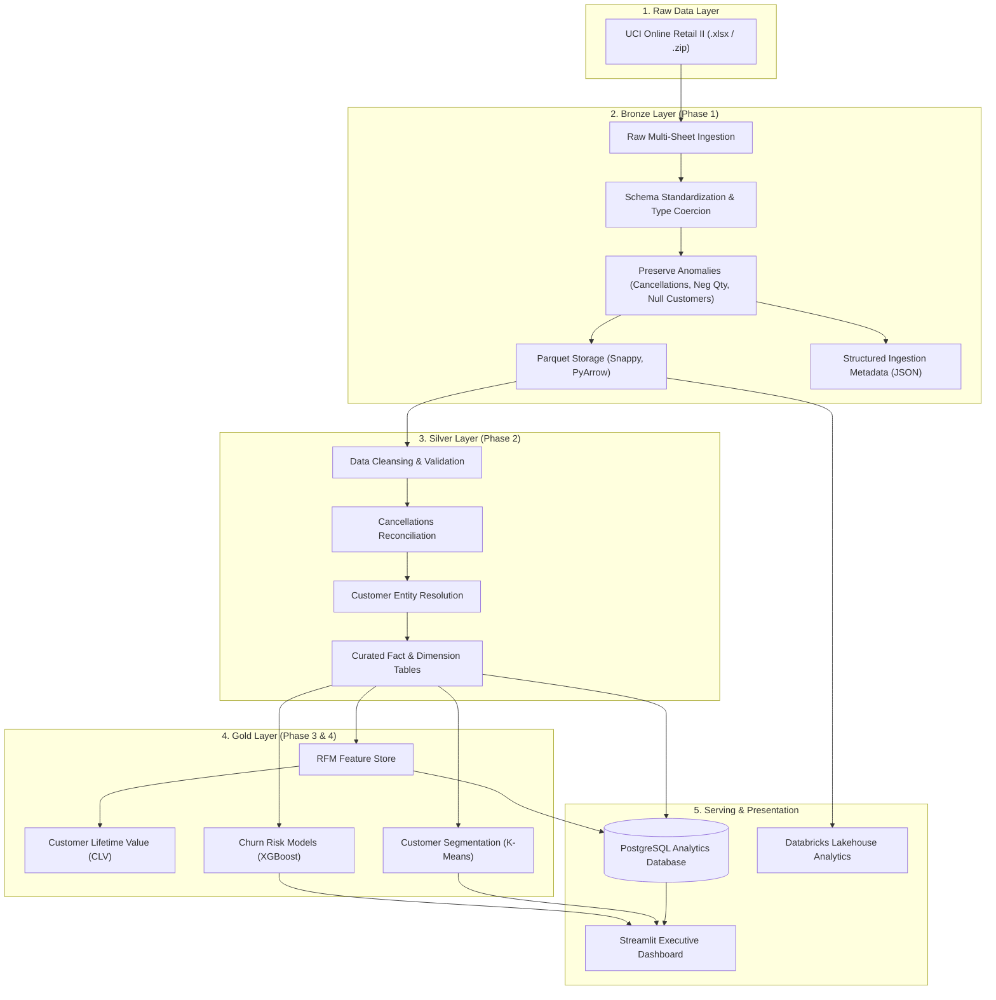

# E-Commerce Intelligence Platform - Architecture

## 1. Executive Summary
The E-Commerce Intelligence Platform is an enterprise-grade lakehouse and predictive analytics system designed to process transaction-level e-commerce data from the UCI Online Retail II dataset, enrich customer and product dimensions, extract behavioral features, and train machine learning models for customer segmentation, churn forecasting, and demand planning.

## 2. Medallion Lakehouse Architecture

## 3. Technology Stack Justification
- **Python 3.12**: Modern language runtime with fast performance, typed dicts, and strict type safety.
- **Pandas & NumPy**: In-memory wrangling and vector math for sheet parsing and initial audit.
- **PyArrow & Parquet**: Columnar format with schema enforcement, Snappy compression, statistics metadata, and cross-platform compatibility.
- **PostgreSQL**: Serving store for dimensional tables, user access, and reporting queries.
- **PySpark & Databricks**: Distributed big data processing for lakehouse operations at scale.
- **Scikit-learn & XGBoost**: Production machine learning for segmentation and customer churn forecasting.
- **Streamlit**: Responsive executive analytics interface.
- **Docker**: Containerized deployment ensuring reproducibility across operating systems.
- **pytest**: Rigorous test-driven verification across all pipeline components.
