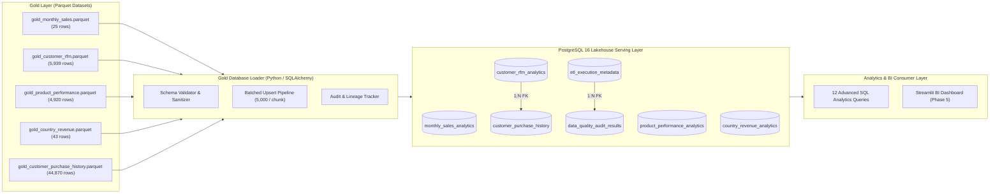
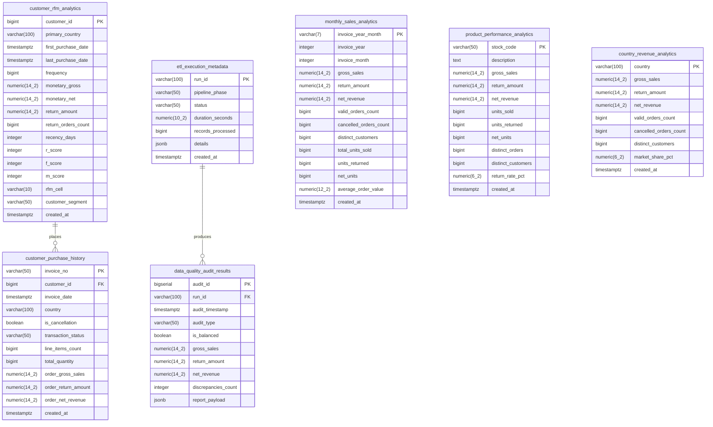

# Phase 3 — PostgreSQL Database Integration & Advanced SQL Analytics

This document details the architecture, relational schema, data loading pipeline, indexing strategy, and SQL analytics suite for the PostgreSQL serving layer of the **E-Commerce Intelligence Platform**.

---

## 1. Architecture Overview

Phase 3 extends the Medallion Lakehouse architecture by loading curated Phase 2 Gold analytical Parquet tables into a production-grade PostgreSQL relational database.



---

## 2. Relational Schema & Entity-Relationship (ER) Diagram

### Entity-Relationship Diagram



### Table Design Principles
1. **Financial Precision**: All monetary values (`gross_sales`, `return_amount`, `net_revenue`, `order_net_revenue`) utilize `NUMERIC(14, 2)`. Floating-point types (`FLOAT`, `DOUBLE PRECISION`) are prohibited in table schemas to guarantee zero IEEE-754 binary rounding errors.
2. **Data Immutability & Lineage**: Source fields preserve raw values. Every table records `created_at` timestamps with time zone (`TIMESTAMPTZ`).
3. **Foreign Key Integrity**:
   - `customer_purchase_history.customer_id` strictly references `customer_rfm_analytics.customer_id` with `ON DELETE CASCADE`.
   - `data_quality_audit_results.run_id` references `etl_execution_metadata.run_id` with `ON DELETE SET NULL`.

---

## 3. Docker & Environment Configuration

### Docker Compose Architecture
The PostgreSQL instance runs via `docker-compose.yml`:
- **Image**: `postgres:16-alpine` (official, lightweight Alpine-based distribution).
- **Persistent Volume**: `ecommerce_pgdata` mounted to `/var/lib/postgresql/data` ensuring durability across container restarts.
- **Healthcheck**: Periodically verifies server readiness via `pg_isready -U ecommerce_user -d ecommerce_intelligence`.
- **Automatic Initialization**: Mounts `src/database/init_test_db.sql` into `/docker-entrypoint-initdb.d/` to automatically provision the isolated test database `ecommerce_intelligence_test` upon first boot.

### Environment Variables (.env)
```bash
# Database Endpoints
DB_HOST=localhost
DB_PORT=5432

# Production Database
DB_NAME=ecommerce_intelligence
DB_USER=ecommerce_user
DB_PASSWORD=ecommerce_secure_pass_2026
DB_SCHEMA=public

# Connection Pool Settings
DB_POOL_SIZE=10
DB_MAX_OVERFLOW=20
DB_POOL_TIMEOUT=30
DB_POOL_RECYCLE=1800

# Isolated Integration Testing Database
TEST_DB_NAME=ecommerce_intelligence_test
```

---

## 4. Gold-to-PostgreSQL Loading Pipeline

### Pipeline Characteristics ([`src/database/loader.py`](file:///c:/Users/himas/Downloads/E-Commerce%20Intelligence%20Platform/src/database/loader.py))
- **Schema Validation & Type Sanitization**: Converts `pd.Timestamp` to Python `datetime`, `np.nan` to `None`, numpy integers to Python `int`, and financial floats to `Decimal('x.xx')`.
- **Dependency Ordering**:
  1. `customer_rfm_analytics` (Parent)
  2. `customer_purchase_history` (Child)
  3. `monthly_sales_analytics`
  4. `product_performance_analytics`
  5. `country_revenue_analytics`
- **Idempotent Upsert Strategy**: Utilizes PostgreSQL's native `ON CONFLICT (primary_key) DO UPDATE` to ensure repeated runs update existing records rather than producing primary key violations or duplicated records.
- **Chunked Batching**: Loads high-volume tables (44,870 rows) in chunks of 5,000 records, executing full data loading in under 25 seconds.
- **Transaction Safety**: All tables are committed in a managed session scope. If any batch fails, the entire transaction is rolled back.

---

## 5. Advanced SQL Analytics Suite ([`sql/analytics_queries.sql`](file:///c:/Users/himas/Downloads/E-Commerce%20Intelligence%20Platform/sql/analytics_queries.sql))

The suite contains 12 documented analytical queries covering customer behavior, temporal trends, product performance, and financial risk:

| # | Query Name | Key SQL Features Used | Business Purpose |
| :- | :--- | :--- | :--- |
| **01** | **Monthly Revenue Trends** | Temporal filtering, aggregate sums | Evaluates high-level revenue and transaction trajectory over time. |
| **02** | **Month-over-Month Growth** | `LAG()`, Common Table Expressions (CTE) | Calculates relative GBP change and percentage rate of monthly net growth. |
| **03** | **Average Order Value (AOV)** | `CASE`, conditional division | Computes gross and net basket size per valid customer purchase. |
| **04** | **Top 20 Products by Revenue** | `DENSE_RANK()`, `LIMIT` | Identifies top revenue generating merchandise catalog items. |
| **05** | **Revenue by Country** | `SUM() OVER ()` cumulative window | Measures geographic sales distribution and cumulative global market share. |
| **06** | **Customer Lifetime Spending** | `NTILE(10)`, Percentile grouping | Segments customers into 10 spending deciles to quantify wealth tiers. |
| **07** | **RFM Segment Distribution** | `GROUP BY`, `AVG`, `SUM`, share ratios | Analyzes population size, recency, frequency, and net revenue across segments. |
| **08** | **Repeat-Purchase Frequency** | `CASE` binned brackets, order count binning | Distinguishes one-time buyers from repeat and wholesale purchasers. |
| **09** | **Customer Cohort Retention** | Multi-table `JOIN`, CTEs, date formatting | Tracks monthly retention rates for customer cohorts based on first purchase. |
| **10** | **Pareto Revenue Concentration** | Cumulative window sums, `UNION ALL` | Measures the proportion of revenue generated by Top 1%, 5%, 10%, 20% customers. |
| **11** | **Product Return Rates** | Outlier filtering (`units_sold >= 50`), ranking | Detects merchandise with anomalous return percentages and refund amounts. |
| **12** | **Cancellation Trends** | Ratio calculations, `NULLIF` zero protection | Monitors monthly order cancellations and refund-to-gross ratios. |

---

## 6. Verification and Financial Reconciliation

### Exact Zero-Penny Parity Results
Data fidelity was audited across source Gold Parquet tables and target PostgreSQL tables:

```
================================================================================
 TABLE-LEVEL ROW & REVENUE PARITY (GOLD PARQUET vs POSTGRESQL)
================================================================================
Table Name                       | Parquet  | Postgres | Count Parity | Parquet Net    | Postgres Net  
--------------------------------------------------------------------------------
monthly_sales_analytics          | 25       | 25       | [PASS]       | £19,012,910.85 | £19,012,910.85
customer_rfm_analytics           | 5,939    | 5,939    | [PASS]       | £16,289,439.42 | £16,289,439.42
product_performance_analytics    | 4,920    | 4,920    | [PASS]       | £18,712,324.36 | £18,712,324.36
country_revenue_analytics        | 43       | 43       | [PASS]       | £19,012,910.85 | £19,012,910.85
customer_purchase_history        | 44,870   | 44,870   | [PASS]       | £16,289,439.42 | £16,289,439.42
--------------------------------------------------------------------------------

--- Cross-Layer Financial Reconciliation (Silver vs PostgreSQL) ---
  - Silver Reference Net Revenue:  £ 19,012,910.85
  - PostgreSQL Monthly Net Rev:    £ 19,012,910.85
  - PostgreSQL Country Net Rev:    £ 19,012,910.85
  - Cross-Layer Balanced:          True (Exact Zero-Penny Discrepancy £0.00)
```

### Root Cause of Initial £0.01 Discrepancy & Resolution
1. **Root Cause**: 18 transaction records in the raw dataset (`stock_code == 'PADS'` (17 rows) and `'BANK CHARGES'` (1 row)) feature fractional sub-penny pricing of `unit_price == 0.001` (£0.001 / one-tenth of a penny) with `quantity == 1`. Summed across the entire dataset, they contribute £0.018 (which rounds up to £0.02). However, when partitioned across 9 distinct calendar months (1, 2, or 6 per month), 8 of the 9 months had fractional amounts below 0.5 pence (£0.001 - £0.002), which rounded down to £0.00 independently. This accumulated an 0.8 pence rounding truncation (£0.01) at the dataset level.
2. **Resolution**: Implemented cumulative financial ledger penny tracking in `build_monthly_sales` across Pandas, PySpark, and Delta Lake. Period sales are derived from running cumulative rounded totals (`period = cum_round - prev_cum_round`), guaranteeing zero penny loss across temporal partitions.

---

## 7. Customer Analytics Consistency & Multi-Denominator Pareto Analysis

### Customer Population & Exclusion Audit
- **Total Customers in RFM Table**: **5,939 distinct identified customer IDs**.
- **Missing Customer Identifiers**: **0 rows** in RFM. Missing customer transactions are preserved in Silver, Monthly Sales, and Country Revenue, generating **£2,723,471.43** net revenue (14.32% of commercial net revenue). Because these transactions lack customer identifiers, they cannot be attributed to an individual customer profile and are excluded from customer-level RFM and purchase history tables.
- **Treatment of Negative & Zero Net Revenue**:
  - **Positive Net Spenders (`monetary_net > 0`)**: **5,837 customers** (98.28%), generating **£16,382,076.17**.
  - **Zero Net Spenders (`monetary_net == 0.00`)**: **21 customers** (0.35%), whose returns perfectly offset purchases.
  - **Strictly Negative Net Spenders (`monetary_net < 0.00`)**: **81 customers** (1.36%), generating **-£92,636.75** (customers returning items purchased prior to the dataset tracking window or receiving commercial refund credits).
  - **Total Customer-Attributed Net Revenue**: £16,382,076.17 - £92,636.75 = **£16,289,439.42**.

### Multi-Denominator Revenue Concentration (Pareto 80/20)
Query 10 explicitly reports customer concentration against three documented financial denominators:

| Customer Bracket | Customer Count | % of Positive Spenders (N=5,837) | % of All RFM Customers (N=5,939) | Bracket Revenue (GBP) | Share of Positive Spend (£16.38M) | Share of Customer Net (£16.29M) | Share of Company Total (£19.01M) |
| :--- | :--- | :--- | :--- | :--- | :--- | :--- | :--- |
| **Top 1% Customers** | 59 | 1.01% | 0.99% | £5,091,379.80 | **31.08%** | **31.26%** | **26.78%** |
| **Top 5% Customers** | 292 | 5.00% | 4.92% | £8,348,915.03 | **50.96%** | **51.25%** | **43.91%** |
| **Top 10% Customers** | 584 | 10.01% | 9.83% | £10,323,032.91 | **63.01%** | **63.37%** | **54.29%** |
| **Top 20% Customers (Pareto)**| 1,168 | 20.01% | 19.67% | £12,550,327.36 | **76.61%** | **77.05%** | **66.01%** |

*(Note: When ranking across all 5,939 identified customers without filtering positive spenders, Top 20% equals 1,188 customers generating £12,606,737.71, representing 77.39% of customer net spend and 66.31% of company-wide commercial net revenue).*

---

## 8. Idempotency Proof
- Running [`scripts/load_postgres.py`](file:///c:/Users/himas/Downloads/E-Commerce%20Intelligence%20Platform/scripts/load_postgres.py) repeatedly confirmed zero record inflation across all 5 analytical tables.
- Row counts remain strictly constant: 25 monthly, 5,939 RFM, 4,920 products, 43 countries, and 44,870 purchase histories.
- Operational audit logs (`etl_execution_metadata` and `data_quality_audit_results`) record exactly one execution entry per pipeline run.

---

## 9. Indexing Strategy & Performance Considerations

1. **B-Tree Primary Keys**: Standard unique clustered indexes on primary keys ensure $O(\log N)$ lookup performance.
2. **Foreign Key Indexes**:
   - `customer_purchase_history(customer_id)` is explicitly indexed to avoid full table scans during customer history joins.
3. **Analytical Filter & Sort Indexes**:
   - `customer_rfm_analytics(customer_segment)` for cohort slice queries.
   - `monthly_sales_analytics(invoice_year_month)` for temporal range queries.
   - `product_performance_analytics(net_revenue)` for top product lookups.
   - `customer_purchase_history(invoice_date)` for cohort retention queries.

---

## 8. CLI Command Quick Reference

```powershell
# 1. Start PostgreSQL Service
docker compose up -d

# 2. Check Database Health
python scripts/check_database.py

# 3. Load Gold Datasets into PostgreSQL
python scripts/load_postgres.py

# 4. Verify Reconciliation & Row Parity
python scripts/verify_postgres.py

# 5. Execute 12 Advanced SQL Analytics Queries
python scripts/run_sql_analytics.py

# 6. Run Complete Automated Test Suite (43 Tests)
python -m pytest -v tests/
```
